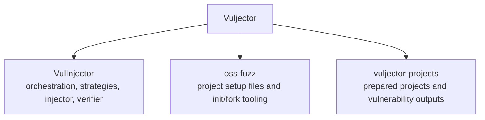
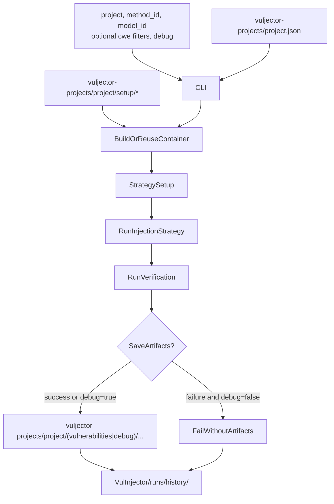

# Vuljector

A framework for generating a security dataset of executable environements by introducing realistic vulnerabilities from OSS-Fuzz projects.

## Table of Contents

- [Installation](#installation)
- [Usage](#usage)
- [Diagrams](#diagrams)
  - [Workspace Layout](#workspace-layout)
  - [End-to-End Flow](#end-to-end-flow)
- [What it does](#what-it-does)
- [Module layout](#module-layout)
- [Outputs](#outputs)
- [Notes](#notes)

## Installation

Set up a workspace where these repositories are siblings:

```text
Vuljector/
  VulInjector/          # orchestration, strategies, injector, verifier
    src/
  oss-fuzz/             # project setup sources + init/fork tooling
  vuljector-projects/   # prepared projects + output vulnerabilities
```

```bash
mkdir Vuljector
cd Vuljector

git clone https://github.com/AmL-Dev/VulInjector VulInjector
git clone https://github.com/vuljector/oss-fuzz oss-fuzz
git clone https://github.com/vuljector/vuljector-projects vuljector-projects
```

Install `uv`:

```bash
curl -LsSf https://astral.sh/uv/install.sh | sh
```

Install Python dependencies:

```bash
cd VulInjector/src
uv sync
```

System requirements:

- Docker
- Git
- Python

## Usage

### First time: initialize a project

Before running a project for the first time, initialize it from `oss-fuzz`:

```bash
cd oss-fuzz/vuljector/init
python3 init_project.py <project>
```

This creates `vuljector-projects/<project>/` with `setup/` and `project.json` including:

- `repos.forked_main_repo`
- `target_dir`
- `secure_base_commit`

### Run

From `VulInjector/src`:

```bash
python3 -m vuljector.vuljector <project> <method_id> <model_id> [--cwe-groups G1,G2] [--cwe-ids 79,89] [--debug]
```

Example:

```bash
python3 -m vuljector.vuljector flask agent_based_full_v1 rchat/gpt-oss-120b --debug
```

Arguments:

| Argument | Required | Description |
|----------|----------|-------------|
| `project` | yes | Project directory name inside `vuljector-projects` (e.g. `flask`) |
| `method_id` | yes | Injection strategy id (currently `agent_based_full_v1`) |
| `model_id` | yes | Model passed to the selected strategy; also recorded in run history filename |
| `--cwe-groups` | no | Comma-separated CWE group names to restrict injection to (e.g. `Input validation,Web`) |
| `--cwe-ids` | no | Comma-separated CWE ids to restrict injection to (e.g. `79,89`) |
| `--debug` | no | Save failed runs under `project/debug/...` for inspection; without this flag failed runs are discarded from the dataset |

If you want VulInjector to run project tests or health checks as part of verification, add an optional `verification.unit_test_cmd` field in `vuljector-projects/<project>/project.json`, for example:

```json
"verification": {
  "unit_test_cmd": "pytest"
}
```

This command is executed inside the container at the repository root; a non-zero exit code marks the run as failed with `UNIT_TESTS_FAILED`.

## Diagrams

### Workspace Layout



### End-to-End Flow



## What it does

Given a project + method + model:

1. Loads `vuljector-projects/<project>/project.json`.
2. Builds/reuses Docker image from `vuljector-projects/<project>/setup/`.
3. Starts/reuses container and ensures clean repo state at `secure_base_commit`.
4. Runs selected strategy inside container.
5. Verifies result:
   - optional unit tests
   - exploit must pass on vulnerable code
   - exploit must fail on secure code
6. Saves artifacts (success, or debug mode) and always writes run telemetry.

## Module layout

- `vuljector/`: CLI + orchestrator
- `vuljector/strategies/`: strategy interface and adapters
- `injector/`: method implementations (e.g. `injector/agent_based_full_v1/`)
- `verifier/`: verification pipeline
- `setup/`: Docker runtime/build/reuse helpers
- `utils/`: shared runner/helpers

## Outputs

### `VulInjector/runs/`

```
VulInjector/runs/
│
├── history/
│   └── <method_id>_<model_id>_<timestamp>_<project>.json   # telemetry for every run
│
└── workspaces/
    └── <project>/
        └── runtime.json   # cached image hash, container id, strategy setup state
```

`history/` is always written, regardless of success or failure. Each file contains: `status`, `failure_cause`, `cwe_group`, `cwe_id`, `vulnerability_ref`, `vulnerable_commit`, `retries`, `models_used`, `token_usage`, `cost`.

### `vuljector-projects/<project>/`

```
vuljector-projects/<project>/
│
├── vulnerabilities/
│   └── vulnerability_N/
│       ├── exploit_files/
│       │   └── exploit.sh
│       └── vulnerability_metadata.json
│
└── debug/
    └── vulnerabilities/
        ├── vulnerability_N/          # debug run that succeeded
        │   ├── exploit_files/
        │   │   └── exploit.sh
        │   └── vulnerability_metadata.json
        └── failed/
            └── vulnerability_N/      # debug run that failed
                └── exploit_files/
```

`vulnerabilities/` is written on success. `debug/` is written when `--debug` is active (both success and failure). Without `--debug`, failed runs leave no artifacts in `vuljector-projects/`.

## Notes

- Runtime does **not** clone repos. Repos are expected in the container from `setup/Dockerfile`.
- If `target_dir` is wrong, runtime fails early with a clear error.
